# Diagramma di Gantt — Ordinachatbot

_Aggiornato il 2026-11-11 da `scripts/piano.py`. Non modificare a mano: cambia `project/tasks.yaml` e rigenera._

Legenda: grigio = fatto, blu chiaro con bordo = in corso, rosso = bloccato, rombi = demo e rilascio. La linea verticale è la data di oggi.

```mermaid
gantt
    title Ordinachatbot — piano di progetto
    dateFormat YYYY-MM-DD
    axisFormat %d/%m
    section Fase 0 Avvio e impostazione
    OC0-01 Repository, piano di progetto, regole di lavoro, spe… :done, oc0_01, 2026-11-10, 2026-11-11
    OC0-08 Demo cliccabile da mostrare ai locali (sito, menu, c… :done, oc0_08, 2026-11-10, 2026-11-11
    OC0-02 Decisioni di architettura (stack, hosting, motore de… :active, oc0_02, 2026-11-11, 2026-11-12
    OC0-03 Scelta del fornitore di pagamenti e conto di prova :active, oc0_03, 2026-11-11, 2026-11-14
    OC0-06 Scelta dell'hardware di riferimento e acquisto di un… :active, oc0_06, 2026-11-11, 2026-11-18
    OC0-07 Verifica fiscale e privacy con un consulente :active, oc0_07, 2026-11-11, 2026-11-18
    OC0-04 Struttura del progetto, controlli di qualità, test e… :oc0_04, 2026-11-12, 2026-11-13
    OC0-05 Ambiente di sviluppo (database, accessi, archivio fo… :oc0_05, 2026-11-12, 2026-11-13
    OC0-09 Regole di sicurezza su allergeni e celiachia — logic… :oc0_09, 2026-11-13, 2026-11-14
    section Fase 1 Locale, menu, aspetto e QR code (Demo 1)
    OC1-01 Schema dei dati multi-locale e isolamento tra locali :oc1_01, 2026-11-13, 2026-11-17
    OC1-04 Componenti grafici di base e struttura del pannello :oc1_04, 2026-11-16, 2026-11-17
    OC1-02 Accesso e ruoli (super amministratore, titolare, cas… :oc1_02, 2026-11-17, 2026-11-18
    OC1-05 Configurazione guidata del locale (dati, tipologie,… :oc1_05, 2026-11-18, 2026-11-19
    OC1-06 Menu — categorie libere con foto, ordine e orari di… :oc1_06, 2026-11-19, 2026-11-20
    OC1-11 Aspetto — logo, 10 combinazioni di colori, 10 temi,… :oc1_11, 2026-11-19, 2026-11-21
    OC1-07 Menu — prodotti con prezzo, descrizione, foto, ingre… :oc1_07, 2026-11-20, 2026-11-24
    OC1-12 Sale e tavoli — creazione, numerazione, posti :oc1_12, 2026-11-23, 2026-11-24
    OC1-08 Scheda ingrediente guidata — allergeni, glutine, ver… :oc1_08, 2026-11-24, 2026-11-26
    OC1-13 QR code dei tavoli — generazione, fogli da stampare… :oc1_13, 2026-11-24, 2026-11-25
    OC1-03 Area super amministratori — crea locale, lavora per… :oc1_03, 2026-11-25, 2026-11-27
    OC1-10 Caricamento e alleggerimento automatico delle foto :oc1_10, 2026-11-25, 2026-11-26
    OC1-14 Menu pubblico consultabile senza chatbot, con la gra… :oc1_14, 2026-11-26, 2026-11-28
    OC1-09 Inserimento veloce — griglia modificabile, duplica,… :oc1_09, 2026-11-27, 2026-12-01
    OC1-15 Locali dimostrativi (uno per tipologia) e Demo 1 :oc1_15, 2026-12-01, 2026-12-02
    Demo 1 — menu, grafica e QR code dei tavoli :milestone, m1, 2026-12-01, 0d
    section Fase 2 Chatbot e ordini dal tavolo (Demo 2)
    OC2-01 Sessione del tavolo — apertura dal QR, partecipanti… :oc2_01, 2026-11-30, 2026-12-02
    OC2-03 Motore del chatbot — capisce la richiesta e cerca ne… :oc2_03, 2026-12-01, 2026-12-04
    OC2-02 Schermata della chat — messaggi, schede prodotto con… :oc2_02, 2026-12-02, 2026-12-04
    OC2-05 Carrello condiviso del tavolo — voci per persona, va… :oc2_05, 2026-12-04, 2026-12-08
    OC2-04 Blocco allergeni e celiachia configurabile e pulsant… :oc2_04, 2026-12-07, 2026-12-08
    OC2-06 Conferma unica per tutto il tavolo e ordini successi… :oc2_06, 2026-12-09, 2026-12-10
    OC2-13 Domande senza risposta — il chatbot le mette da part… :oc2_13, 2026-12-09, 2026-12-10
    OC2-07 Stati dell'ordine e storico :oc2_07, 2026-12-10, 2026-12-11
    OC2-14 Il gestore risponde con calma e il chatbot impara :oc2_14, 2026-12-10, 2026-12-12
    OC2-08 Scelta del pagamento in cassa e regole del locale (s… :oc2_08, 2026-12-11, 2026-12-12
    OC2-11 Schermo ordini per il personale, in tempo reale con… :oc2_11, 2026-12-17, 2026-12-19
    OC2-15 Prove severe su allergeni e celiachia (obbligatorie… :oc2_15, 2026-12-18, 2026-12-22
    OC2-09 Protezioni — ordini da fuori locale, limiti, tavolo… :oc2_09, 2026-12-21, 2026-12-22
    OC2-10 Lingue — italiano e inglese per menu e chatbot :oc2_10, 2026-12-22, 2026-12-23
    OC2-12 Prove complete del chatbot e Demo 2 :oc2_12, 2026-12-28, 2026-12-29
    Demo 2 — si ordina dal tavolo con il chatbot :milestone, m2, 2026-12-28, 0d
    section Fase 3 Pagamenti dal tavolo (Demo 3)
    OC3-01 Collegamento del conto di incasso del locale :oc3_01, 2026-12-04, 2026-12-08
    OC3-02 Pagamento dal tavolo con Apple Pay, Google Pay e car… :oc3_02, 2026-12-14, 2026-12-16
    OC3-05 Conferma dell'incasso, invio in cucina dopo il pagam… :oc3_05, 2026-12-16, 2026-12-18
    OC3-04 Pagamento con Bancomat Pay :oc3_04, 2026-12-23, 2026-12-29
    OC3-06 Conto del tavolo — paga tutto, paga la tua parte, di… :oc3_06, 2026-12-23, 2026-12-29
    OC3-03 Pagamento con Satispay e Revolut Pay :oc3_03, 2026-12-29, 2026-12-30
    OC3-07 Ricevuta al cliente e riepilogo incassi per il titol… :oc3_07, 2026-12-29, 2026-12-30
    OC3-08 Prove in ambiente di test dei pagamenti e Demo 4 :oc3_08, 2027-01-04, 2027-01-05
    Demo 3 — si paga dal tavolo :milestone, m3, 2027-01-04, 0d
    section Fase 4 Stampanti per le comande (Demo 4)
    OC4-01 Servizio di stampa — coda, formato della comanda, ri… :oc4_01, 2026-12-11, 2026-12-15
    OC4-02 Collegamento delle stampanti termiche del locale :oc4_02, 2026-12-15, 2026-12-17
    OC4-03 Zone di stampa (cucina, pizzeria, bar, cassa) e cate… :oc4_03, 2026-12-22, 2026-12-23
    OC4-04 Controllo delle stampanti — carta finita, spenta, st… :oc4_04, 2026-12-30, 2026-12-31
    OC4-05 Collaudo sul kit reale e Demo 3 :oc4_05, 2027-01-04, 2027-01-05
    Demo 4 — le comande escono dalla stampante :milestone, m4, 2027-01-04, 0d
    section Fase 5 Sito, domini, SaaS e rilascio della ver…
    OC5-05 Privacy — informative, cookie, conservazione dei dat… :oc5_05, 2027-01-04, 2027-01-06
    OC5-07 Sicurezza, copie di salvataggio, controllo del servi… :oc5_07, 2027-01-05, 2027-01-08
    OC5-08 Manuale definitivo con le schermate e guida di avvio… :oc5_08, 2027-01-11, 2027-01-12
    OC5-02 Indirizzi — sottodominio nostro e dominio proprio de… :oc5_02, 2027-01-12, 2027-01-14
    OC5-09 Locale pilota — installazione e prova con clienti ve… :oc5_09, 2027-01-12, 2027-01-15
    OC5-01 Sito del locale (facoltativo) — social, contatti, or… :oc5_01, 2027-01-14, 2027-01-16
    OC5-03 Passaggio dal nostro dominio a quello del locale sen… :oc5_03, 2027-01-15, 2027-01-16
    OC5-04 Piani e moduli SaaS (base, stampanti, pagamenti, cas… :oc5_04, 2027-01-18, 2027-01-19
    OC5-06 Statistiche per il titolare (più ordinati, orari di… :oc5_06, 2027-01-18, 2027-01-19
    OC5-10 Rilascio versione 1 :oc5_10, 2027-01-19, 2027-01-20
    Versione 1 in vendita — chatbot, pagamenti, stamp… :milestone, m5, 2027-01-19, 0d
    section Fase 6 Cassa e gestionale, dopo il rilascio (v…
    OC6-01 Attivazione del modulo cassa per locale e postazioni… :oc6_01, 2026-11-26, 2026-11-27
    OC6-02 Reparti, aliquote IVA, metodi di pagamento, coperto… :oc6_02, 2026-12-30, 2026-12-31
    OC6-03 Schermata di cassa per monitor touch — vendita veloc… :oc6_03, 2027-01-07, 2027-01-09
    OC6-04 Mappa dei tavoli — stati a colori, apri, sposta, uni… :oc6_04, 2027-01-08, 2027-01-12
    OC6-05 Conto del tavolo in cassa — preconto, sconti, divisi… :oc6_05, 2027-01-14, 2027-01-16
    OC6-07 Stampante fiscale RT — scontrino, annullo, reso, lot… :oc6_07, 2027-01-19, 2027-01-22
    OC6-08 Apertura e chiusura giornaliera, fondo cassa, turni… :oc6_08, 2027-01-20, 2027-01-22
    OC6-10 Resoconti — incassi per metodo, reparto, prodotto, f… :oc6_10, 2027-02-01, 2027-02-03
    OC6-06 Ordini del chatbot in cassa in automatico pagato dal… :oc6_06, 2027-02-02, 2027-02-03
    OC6-09 Storni e annulli con permessi per operatore e regist… :oc6_09, 2027-02-03, 2027-02-04
    OC6-11 Cassa utilizzabile senza internet e ripresa automati… :oc6_11, 2027-02-03, 2027-02-05
    OC6-12 Collaudo sul kit reale e Demo 5 :oc6_12, 2027-02-04, 2027-02-05
    Cassa e gestionale — modulo in vendita :milestone, m6, 2027-02-04, 0d
    section Fase 7 Altre funzioni dopo il rilascio
    OC7-01 Registrazione autonoma dei locali e pagamento dell'a… :oc7_01, 2027-01-22, 2027-01-27
    OC7-03 Asporto e consegna a domicilio :oc7_03, 2027-01-22, 2027-01-28
    OC7-02 Prenotazione dei tavoli :oc7_02, 2027-01-27, 2027-01-30
    OC7-04 Altre lingue, offerte a orario (es. aperitivo), racc… :oc7_04, 2027-01-28, 2027-02-02
```

## Date previste

| Task | Titolo | Stato | Chi | Inizio | Fine |
|---|---|---|---|---|---|
| OC0-01 | Repository, piano di progetto, regole di lavoro, specifiche e manuale (bozza) | fatto | Claude | 10/11/2026 | 10/11/2026 |
| OC0-08 | Demo cliccabile da mostrare ai locali (sito, menu, chatbot, vista gestore) | fatto | Claude | 10/11/2026 | 10/11/2026 |
| OC0-02 | Decisioni di architettura (stack, hosting, motore del chatbot) | in corso | Paolo | 11/11/2026 | 11/11/2026 |
| OC0-03 | Scelta del fornitore di pagamenti e conto di prova | in corso | Paolo | 11/11/2026 | 13/11/2026 |
| OC0-06 | Scelta dell'hardware di riferimento e acquisto di un kit di prova | in corso | Paolo | 11/11/2026 | 17/11/2026 |
| OC0-07 | Verifica fiscale e privacy con un consulente | in corso | Paolo | 11/11/2026 | 17/11/2026 |
| OC0-04 | Struttura del progetto, controlli di qualità, test e CI su GitHub Actions | da fare |  | 12/11/2026 | 12/11/2026 |
| OC0-05 | Ambiente di sviluppo (database, accessi, archivio foto, variabili d'ambiente) | da fare |  | 12/11/2026 | 12/11/2026 |
| OC0-09 | Regole di sicurezza su allergeni e celiachia — logica comune con prove automatiche | da fare |  | 13/11/2026 | 13/11/2026 |
| OC1-01 | Schema dei dati multi-locale e isolamento tra locali | da fare |  | 13/11/2026 | 16/11/2026 |
| OC1-04 | Componenti grafici di base e struttura del pannello | da fare |  | 16/11/2026 | 16/11/2026 |
| OC1-02 | Accesso e ruoli (super amministratore, titolare, cassa, sala, cucina) | da fare |  | 17/11/2026 | 17/11/2026 |
| OC1-05 | Configurazione guidata del locale (dati, tipologie, orari, moduli attivi) | da fare |  | 18/11/2026 | 18/11/2026 |
| OC1-06 | Menu — categorie libere con foto, ordine e orari di disponibilità | da fare |  | 19/11/2026 | 19/11/2026 |
| OC1-11 | Aspetto — logo, 10 combinazioni di colori, 10 temi, anteprima dal vivo | da fare |  | 19/11/2026 | 20/11/2026 |
| OC1-07 | Menu — prodotti con prezzo, descrizione, foto, ingredienti, varianti e aggiunte | da fare |  | 20/11/2026 | 23/11/2026 |
| OC1-12 | Sale e tavoli — creazione, numerazione, posti | da fare |  | 23/11/2026 | 23/11/2026 |
| OC1-08 | Scheda ingrediente guidata — allergeni, glutine, verifica dell'etichetta | da fare |  | 24/11/2026 | 25/11/2026 |
| OC1-13 | QR code dei tavoli — generazione, fogli da stampare in PDF, rigenerazione | da fare |  | 24/11/2026 | 24/11/2026 |
| OC1-03 | Area super amministratori — crea locale, lavora per conto del locale, sospendi | da fare |  | 25/11/2026 | 26/11/2026 |
| OC1-10 | Caricamento e alleggerimento automatico delle foto | da fare |  | 25/11/2026 | 25/11/2026 |
| OC1-14 | Menu pubblico consultabile senza chatbot, con la grafica del locale | da fare |  | 26/11/2026 | 27/11/2026 |
| OC6-01 | Attivazione del modulo cassa per locale e postazioni di cassa | da fare |  | 26/11/2026 | 26/11/2026 |
| OC1-09 | Inserimento veloce — griglia modificabile, duplica, importa da Excel, prezzi in blocco, esaurito | da fare |  | 27/11/2026 | 30/11/2026 |
| OC2-01 | Sessione del tavolo — apertura dal QR, partecipanti con nome, tempo reale | da fare |  | 30/11/2026 | 01/12/2026 |
| OC1-15 | Locali dimostrativi (uno per tipologia) e Demo 1 | da fare |  | 01/12/2026 | 01/12/2026 |
| OC2-03 | Motore del chatbot — capisce la richiesta e cerca nel menu | da fare |  | 01/12/2026 | 03/12/2026 |
| OC2-02 | Schermata della chat — messaggi, schede prodotto con foto, pulsanti di scelta | da fare |  | 02/12/2026 | 03/12/2026 |
| OC2-05 | Carrello condiviso del tavolo — voci per persona, varianti, note per la cucina | da fare |  | 04/12/2026 | 07/12/2026 |
| OC3-01 | Collegamento del conto di incasso del locale | da fare |  | 04/12/2026 | 07/12/2026 |
| OC2-04 | Blocco allergeni e celiachia configurabile e pulsante «Chiama il cameriere» | da fare |  | 07/12/2026 | 07/12/2026 |
| OC2-06 | Conferma unica per tutto il tavolo e ordini successivi | da fare |  | 09/12/2026 | 09/12/2026 |
| OC2-13 | Domande senza risposta — il chatbot le mette da parte per il gestore | da fare |  | 09/12/2026 | 09/12/2026 |
| OC2-07 | Stati dell'ordine e storico | da fare |  | 10/12/2026 | 10/12/2026 |
| OC2-14 | Il gestore risponde con calma e il chatbot impara | da fare |  | 10/12/2026 | 11/12/2026 |
| OC2-08 | Scelta del pagamento in cassa e regole del locale (subito o a fine pasto) | da fare |  | 11/12/2026 | 11/12/2026 |
| OC4-01 | Servizio di stampa — coda, formato della comanda, ristampa | da fare |  | 11/12/2026 | 14/12/2026 |
| OC3-02 | Pagamento dal tavolo con Apple Pay, Google Pay e carta | da fare |  | 14/12/2026 | 15/12/2026 |
| OC4-02 | Collegamento delle stampanti termiche del locale | da fare |  | 15/12/2026 | 16/12/2026 |
| OC3-05 | Conferma dell'incasso, invio in cucina dopo il pagamento, errori e rimborsi | da fare |  | 16/12/2026 | 17/12/2026 |
| OC2-11 | Schermo ordini per il personale, in tempo reale con avviso sonoro | da fare |  | 17/12/2026 | 18/12/2026 |
| OC2-15 | Prove severe su allergeni e celiachia (obbligatorie prima di ogni rilascio) | da fare |  | 18/12/2026 | 21/12/2026 |
| OC2-09 | Protezioni — ordini da fuori locale, limiti, tavolo chiuso | da fare |  | 21/12/2026 | 21/12/2026 |
| OC2-10 | Lingue — italiano e inglese per menu e chatbot | da fare |  | 22/12/2026 | 22/12/2026 |
| OC4-03 | Zone di stampa (cucina, pizzeria, bar, cassa) e categorie associate | da fare |  | 22/12/2026 | 22/12/2026 |
| OC3-04 | Pagamento con Bancomat Pay | da fare |  | 23/12/2026 | 28/12/2026 |
| OC3-06 | Conto del tavolo — paga tutto, paga la tua parte, dividi in parti uguali, mancia | da fare |  | 23/12/2026 | 28/12/2026 |
| OC2-12 | Prove complete del chatbot e Demo 2 | da fare |  | 28/12/2026 | 28/12/2026 |
| OC3-03 | Pagamento con Satispay e Revolut Pay | da fare |  | 29/12/2026 | 29/12/2026 |
| OC3-07 | Ricevuta al cliente e riepilogo incassi per il titolare | da fare |  | 29/12/2026 | 29/12/2026 |
| OC4-04 | Controllo delle stampanti — carta finita, spenta, stampa di riserva, avvisi | da fare |  | 30/12/2026 | 30/12/2026 |
| OC6-02 | Reparti, aliquote IVA, metodi di pagamento, coperto e servizio | da fare |  | 30/12/2026 | 30/12/2026 |
| OC3-08 | Prove in ambiente di test dei pagamenti e Demo 4 | da fare |  | 04/01/2027 | 04/01/2027 |
| OC4-05 | Collaudo sul kit reale e Demo 3 | da fare |  | 04/01/2027 | 04/01/2027 |
| OC5-05 | Privacy — informative, cookie, conservazione dei dati, contratto con i locali | da fare |  | 04/01/2027 | 05/01/2027 |
| OC5-07 | Sicurezza, copie di salvataggio, controllo del servizio, prova di carico | da fare |  | 05/01/2027 | 07/01/2027 |
| OC6-03 | Schermata di cassa per monitor touch — vendita veloce al banco | da fare |  | 07/01/2027 | 08/01/2027 |
| OC6-04 | Mappa dei tavoli — stati a colori, apri, sposta, unisci | da fare |  | 08/01/2027 | 11/01/2027 |
| OC5-08 | Manuale definitivo con le schermate e guida di avvio per i locali | da fare |  | 11/01/2027 | 11/01/2027 |
| OC5-02 | Indirizzi — sottodominio nostro e dominio proprio del locale con certificato | da fare |  | 12/01/2027 | 13/01/2027 |
| OC5-09 | Locale pilota — installazione e prova con clienti veri | da fare |  | 12/01/2027 | 14/01/2027 |
| OC5-01 | Sito del locale (facoltativo) — social, contatti, orari, mappa, pulsante menu | da fare |  | 14/01/2027 | 15/01/2027 |
| OC6-05 | Conto del tavolo in cassa — preconto, sconti, divisione, pagamenti misti | da fare |  | 14/01/2027 | 15/01/2027 |
| OC5-03 | Passaggio dal nostro dominio a quello del locale senza ristampare i QR | da fare |  | 15/01/2027 | 15/01/2027 |
| OC5-04 | Piani e moduli SaaS (base, stampanti, pagamenti, cassa, sito) | da fare |  | 18/01/2027 | 18/01/2027 |
| OC5-06 | Statistiche per il titolare (più ordinati, orari di punta, spesa media) | da fare |  | 18/01/2027 | 18/01/2027 |
| OC5-10 | Rilascio versione 1 | da fare |  | 19/01/2027 | 19/01/2027 |
| OC6-07 | Stampante fiscale RT — scontrino, annullo, reso, lotteria degli scontrini | da fare |  | 19/01/2027 | 21/01/2027 |
| OC6-08 | Apertura e chiusura giornaliera, fondo cassa, turni degli operatori | da fare |  | 20/01/2027 | 21/01/2027 |
| OC7-01 | Registrazione autonoma dei locali e pagamento dell'abbonamento | da fare |  | 22/01/2027 | 26/01/2027 |
| OC7-03 | Asporto e consegna a domicilio | da fare |  | 22/01/2027 | 27/01/2027 |
| OC7-02 | Prenotazione dei tavoli | da fare |  | 27/01/2027 | 29/01/2027 |
| OC7-04 | Altre lingue, offerte a orario (es. aperitivo), raccolta punti | da fare |  | 28/01/2027 | 01/02/2027 |
| OC6-10 | Resoconti — incassi per metodo, reparto, prodotto, fascia oraria; esportazione | da fare |  | 01/02/2027 | 02/02/2027 |
| OC6-06 | Ordini del chatbot in cassa in automatico; pagato dal tavolo = conto saldato | da fare |  | 02/02/2027 | 02/02/2027 |
| OC6-09 | Storni e annulli con permessi per operatore e registro delle operazioni | da fare |  | 03/02/2027 | 03/02/2027 |
| OC6-11 | Cassa utilizzabile senza internet e ripresa automatica | da fare |  | 03/02/2027 | 04/02/2027 |
| OC6-12 | Collaudo sul kit reale e Demo 5 | da fare |  | 04/02/2027 | 04/02/2027 |
